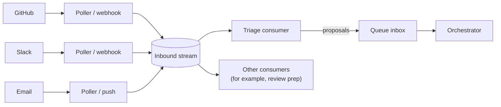

# Inbound events

Turning things that arrive (PR review requests, Slack messages, emails) into todos. Summary in [DESIGN.md](../../DESIGN.md). Not in the MVP; this spec fixes the shape so the MVP doesn't block it.

## Pipeline

## Envelope

Every source produces the same record:

| Field | Purpose |
|---|---|
| `event_id` | Our ID |
| `source`, `external_id` | Deduplication: the same item polled twice is stored once |
| `thread_key` | Grouping: for example `github:org/repo#42`, so a review request and later comments update one todo |
| `kind` | `review_requested`, `mention`, `dm`, `ci_failed`, `email`, … |
| `actor`, `title`, `url` | Who, what, and where to look |
| `occurred_at`, `received_at` | Ordering and latency |
| `payload` | Source-specific detail, stored but never executed |

## Sources

| Source | Polling first | Push later |
|---|---|---|
| GitHub | Notifications API and `review-requested:@me` searches | Webhooks or a GitHub App |
| Slack | DMs, mentions, and threads you're in | Events API |
| Email | Gmail history since the last ID | Gmail push through Pub/Sub |

Each source config names the account it reads as. A poller stores its own cursor, such as a timestamp or history ID.

## Stream

- **Start with a table** (`inbound_events`) in the Orchestrator's store, with a cursor per consumer. It is the same pattern as the event log: replayable, and new consumers start from any point.
- **Move to a broker** (for example NATS JetStream or Redis Streams) when the Orchestrator moves to the cloud and webhooks need a public endpoint. Pollers and webhooks become producers; consumers keep their cursors. Only the transport changes.

## Triage

- **Rules first.** Cheap and predictable, for example: review request from a teammate → kind `review`, urgency 3; a P0-labeled incident → P0.
- **Then a model call** for what the rules don't settle: a headless call with no tools and schema-validated output. It returns a todo proposal (kind, importance, urgency, `why`) or "ignore" with a reason.
- **One todo per thread.** A new event on a known thread updates that todo, raising urgency if warranted, instead of creating another.
- **The Orchestrator is told, not interrupted.** Proposals land in the queue inbox and appear in the per-turn state. P0 items are announced immediately.
- **Corrections are recorded.** When you change a triaged todo's scores or drop it, that becomes a triage example.

## Trust

Inbound content is written by other people and is untrusted: an email can say "delete the repo". So:
- Triage consumers have **no tools with side effects.** They can only create or update proposals.
- Event content reaches workers only through a brief the Orchestrator writes, under the normal delegation rules and permission policy.
- Source credentials are read-only where the source allows it.

## Open questions

- Which broker, and when to move to it.
- Whether triage runs in the Orchestrator process or as separate consumer processes.
- How much history to backfill when a source is first connected.
