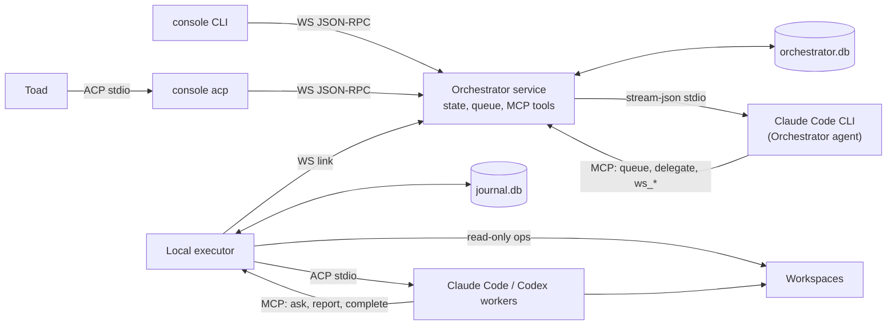

# Topology

How the processes fit together, and why they are split this way. Summary in [DESIGN.md](../../DESIGN.md).

## MVP



## Processes

| Process | Owns | Does not own |
|---|---|---|
| **Orchestrator service** (`console orchestrator`) | The store, event log, queue, task engine, client API, executor hub, and the MCP tool server the agent uses | Workspaces, model reasoning |
| **Orchestrator agent** (Claude Code CLI, hosted by the service) | Reasoning: conversation, inline lookups, delegation decisions | Any state of record |
| **Executor** (`console executor`) | Workspace registry, command journal, read-only ops, worker processes | Task truth (the Orchestrator owns it) |
| **Workers** (Claude Code or Codex, hosted by the executor) | One task's coding work in one workspace | Anything beyond their task |
| **Clients** (Toad through `console acp`, the `console` CLI) | Rendering and input | Any state; they can disconnect at any time |

## Choices

- **Service and agent are separate processes.** The agent is replaceable: it can crash, be resumed, be swapped for another harness, or move with the service to the cloud. Because the service's records are authoritative, nothing is lost when it does.
- **The executor connects to the Orchestrator, even locally.** Local mode uses the same link as cloud mode, so the cloud move changes deployment, not protocol. Which side dials is configurable ([executors](executors.md#cloud-executors)).
- **The Orchestrator reaches workspaces only through the executor.** Inline lookups are executor read ops. This keeps the Orchestrator portable and puts all workspace access control in one place.
- **Clients speak one API.** JSON-RPC over WebSocket ([clients](clients.md)). Toad reaches it through an ACP bridge, so Toad never knows whether the Orchestrator is local or remote.

## Deployment over time

| Stage | Orchestrator | Executors | Clients |
|---|---|---|---|
| MVP | Laptop | Laptop | Toad, CLI on the laptop |
| Cloud executors | Laptop | Laptop + cloud | Same |
| Cloud Orchestrator (later) | Cloud | Laptop + cloud | Same, plus Slack and desktop |

## Repository layout

```
crates/
  proto/         IDs, enums, events, client API, executor link messages
  config/        layered configuration
  store/         SQLite migrations, repositories, event log
  queue/         queue ranking, proposals, field ownership (pure logic)
  orchestrator/  service: client API, task engine, executor hub
  client/        Rust client for the client API
  cc-host/       hosts the Orchestrator's Claude Code CLI
  agent/         Orchestrator agent: system prompt, hooks, MCP tools, briefs
  executor/      executor daemon
  acp-host/      hosts ACP workers (Claude Code, Codex)
  acp-bridge/    `console acp` for Toad
  console/       the binary
```
