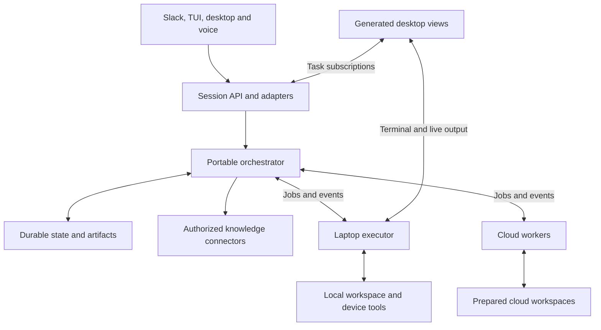
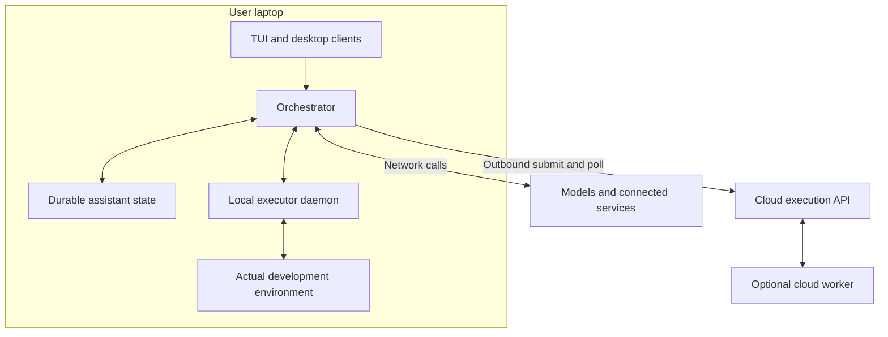
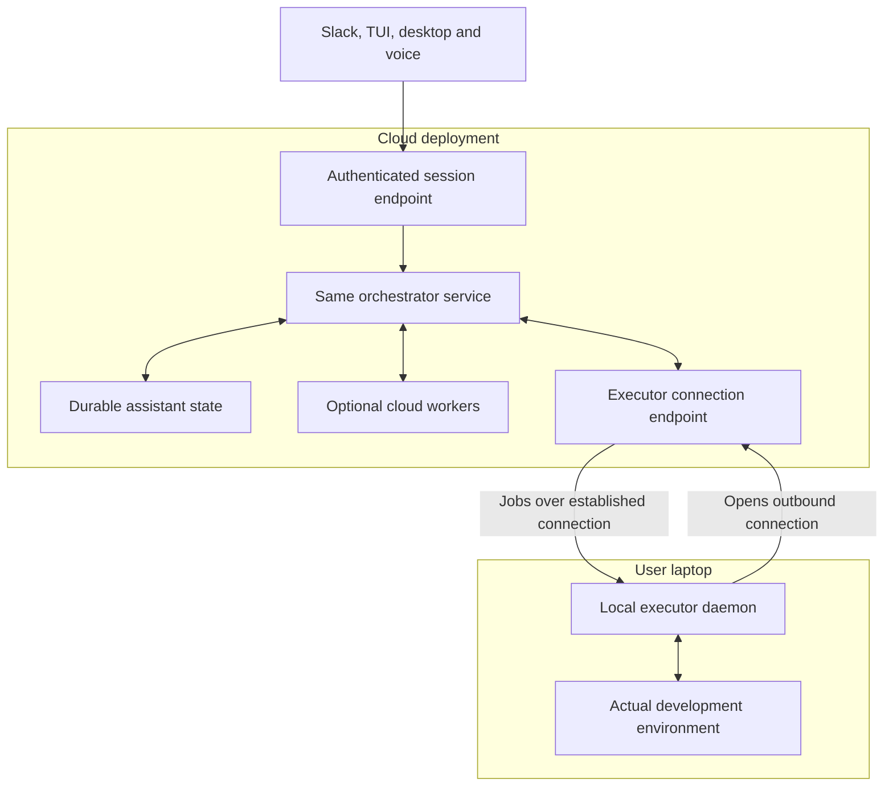
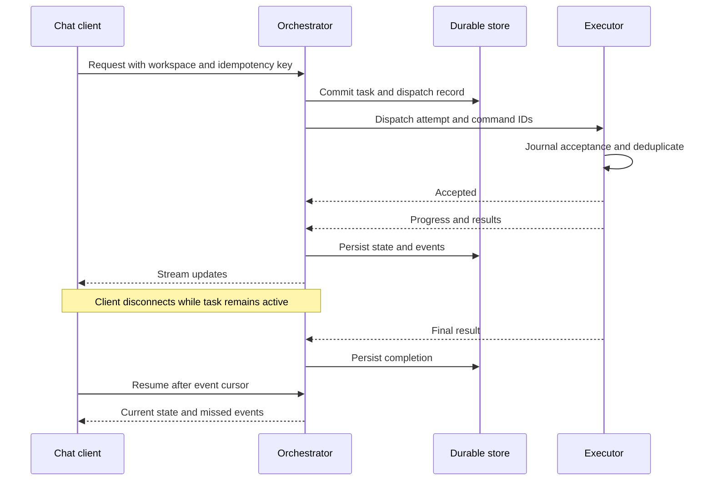
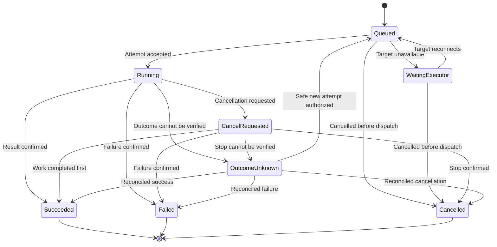
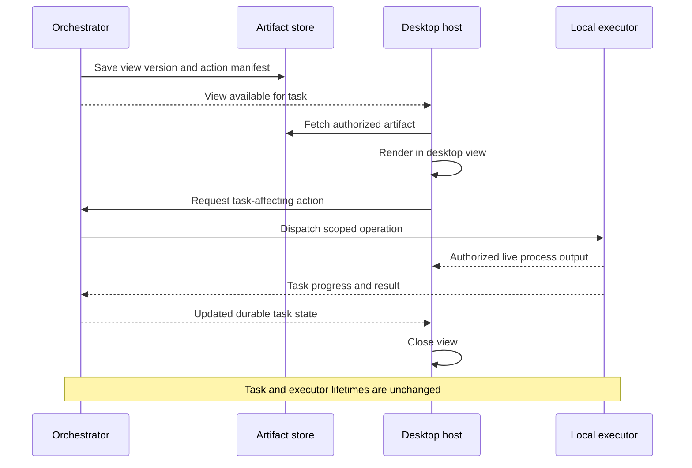

# Architecture design: a portable engineering assistant

**Date:** November 22, 2026  
**Status:** Accepted product direction with proposed implementation mechanics. This is a design, not a claim that the system has been built.  
**Companion:** [Industry research](industry-research.md)

## 1. Architecture in one paragraph

Build a persistent assistant around **one orchestrator implementation that can run either locally or in the cloud**. A separate local executor daemon gives it access to the user's actual development environment and laptop capabilities. Optional cloud workers handle suitable remote work. Slack, the TUI, desktop chat, generated desktop views, and full-duplex voice connect to the same session and task system. Memory, work, and artifacts persist independently of any client. The orchestrator normally chooses models, harnesses, and execution targets according to task requirements and configured policy.

The orchestrator's location is a deployment choice. It does not change the product's fundamental contracts, and it does not relocate the laptop's working files.

## 2. Decisions and their status

### Accepted direction

| Decision | Architectural consequence |
|---|---|
| The orchestrator can run locally or in the cloud. | Use the same core service and contracts in both modes. |
| Each assistant has one active authoritative orchestrator. | Avoid simultaneous local/cloud authorities and automatic merging of their state. |
| Local execution must reach the real development environment. | Keep an independently managed laptop executor with explicit workspace identity. |
| Cloud execution is available when useful. | Treat cloud workers as registered execution targets, not substitutes for all local capabilities. |
| Interfaces include Slack, TUI, GUI/chat, and full-duplex voice. | Clients attach to durable sessions and tasks rather than owning agent lifetimes. |
| Generate task-specific interfaces on the user's machine. | Use a stable installed desktop host with generated views and actionable controls. |
| Persist memory, files, tasks, and agent activity. | Give each category explicit storage ownership and lifecycle. |
| Hide routine model, harness, and placement choices. | Introduce capability-aware routing with sensible defaults and inspectable decisions. |
| Integrate through APIs, MCP, and CLIs. | Support adapters without forcing all services into a single integration mechanism. |
| The user and the Orchestrator stay in sync through one shared priority queue of todos. | The queue is durable orchestrator state with explicit field ownership; every client renders the same queue, and the Orchestrator pulls its own work from it. |
| Updates use progressive disclosure: high level first, more detail on request. | Updates are layered digests grounded in the event log, so each deeper level expands the one above it without contradicting it. |
| The Orchestrator is a conversational agent that delegates only non-trivial work. | Messages are conversation turns, not tasks. Tasks are created by an explicit, recorded delegation decision with read-only inline limits enforced in code (§3.4). |
| The Orchestrator learns how much detail the user wants for each kind of work. | Disclosure preferences are inspectable memory keyed by task type and priority, learned from explicit statements and expand/collapse behavior. |

### Proposed mechanics, not finalized selections

The service language, database, event transport, queue, hosting provider, model providers, coding harness, and memory implementation remain open. Electron is a strong desktop-host candidate. Toad, Pi TUI, and OpenTUI are frontend candidates. A core session API with an ACP adapter is a proposal, not an accepted requirement to use ACP everywhere.

The initial design should support moving a stopped or quiesced orchestrator between deployment modes. Live migration, active/active coordination, and automatic offline failover are outside the initial scope.

## 3. Product contract

The assistant should support a complete engineering loop: clarify the goal, plan the work, execute changes, verify them, walk through the result, and prepare a review or shipping decision. PR review and ongoing todo tracking are related workflows with their own durable state.

The user can start in one interface and continue in another. A Slack thread may lead to a laptop task; a voice conversation may open a generated diff viewer; the TUI may attach to a task that started in desktop chat. Continuity means the same authorized task and its evidence remain available. It does not mean every channel receives all private context.

The terminal must support real human interaction, including interactive commands and process output. It should not merely display commands selected by the agent. Generated views should expose the controls that fit the task: navigating a walkthrough, filtering test failures, comparing diffs, managing todos, or investigating telemetry.

### 3.1 A shared priority queue

The user and the Orchestrator work from **one priority queue of todos**. It is the main way the two stay in sync about what matters, what is in flight, and what is waiting on whom.

- A **todo** is what needs doing. A **task** (§8) is a unit of agent work toward a todo. A todo can have zero tasks (owned by the user, such as "reply to the design review") or several attempts over time.
- Each todo has an owner (user or Orchestrator), a kind (feature, bugfix, review, investigation, ops, chore, question), importance, urgency or a due date, dependencies, and a status (`inbox`, `ready`, `active`, `blocked`, `waiting_on_user`, `done`, `dropped`).
- Order comes from a deterministic, explainable ranking: a priority band from importance × urgency, a score within the band, and manual placement by the user that sticks. The Orchestrator can always say why an item sits where it does.
- **Field ownership:** values the user set are authoritative. The Orchestrator may set fields on items it created, and it may *propose* changes to anything else (for example, "raise this to P0: main has been red for 2 hours"). The user accepts or rejects proposals; nothing user-set is silently overwritten.
- The Orchestrator **pulls its own work from the queue**: ready, agent-executable items it owns are started in rank order, within concurrency and policy limits.
- Agents can add follow-up todos they discover, but these arrive in `inbox` as proposals, not as ranked work.
- Every queue change is an event. All clients (TUI, Slack, desktop, voice) render the same queue and the same "waiting on you" list.

### 3.2 Progressive disclosure

Updates start high level and get more detailed only when the user asks.

| Level | Content | How it is produced |
|---|---|---|
| L0 headline | One line: outcome and whether the user is needed | Generated at milestones |
| L1 brief | A few bullets: what changed, what needs the user, risks | Generated at milestones |
| L2 detail | Plan steps, files and diffstat, test results, decisions made and why, open questions | Generated on request, then cached |
| L3 evidence | Transcript, tool calls, logs, full diff | Links to the event log and artifacts; never summarized |

Each digest records the event range it covers, so "more detail" always expands the same facts rather than producing a new account. Items that need the user are always included, whatever the preferred level.

The same principle applies to **queue sync**: "what changed since I last looked" starts as a headline (3 done, 1 waiting on you, 2 re-ranked) and expands per item.

### 3.3 Learned detail preferences

The Orchestrator learns how much detail the user wants, and how urgently they want to hear it, for each **kind of work and priority band**. A P0 incident may warrant L1 pushed immediately; a P3 chore may warrant an L0 batched into the next sync; reviews may warrant L2.

- **Explicit statements** ("give me just the headline for chores") are recorded and pinned.
- **Learned behavior** comes from what the user does with updates: expanding, collapsing, ignoring, or asking a follow-up that a deeper level would have answered.
- Changes are gradual, need several consistent signals, and are announced once ("I'll include more detail for reviews; you expanded the last four").
- Preferences are inspectable and editable, like any other memory (§12). Sparse categories fall back to broader ones (kind only, then band only, then a global default).

### 3.4 Conversation first, delegation when warranted

The Orchestrator is itself an agent and the user's primary conversational partner. **Not every message is a task.** The Orchestrator handles conversational work itself and delegates only work that would pull the user and the Orchestrator out of the conversation.

| Handled inline by the Orchestrator | Delegated to a dedicated worker agent (a task) |
|---|---|
| Questions, explanations, planning discussion | Any change to a workspace |
| Short read-only lookups: read a file, grep, git status or log, view a PR | Work expected to take more than a minute or two, or many steps |
| Queue, todo, preference, and task-status operations | Builds, test runs, multi-step investigations, non-trivial PR reviews |
| Drafting text that does not touch a workspace | Anything the user would naturally hand off and check back on |

- **Delegation creates durable work.** The Orchestrator writes a task brief (goal, context from the conversation, constraints, acceptance criteria), links it to a todo, and starts a worker on the right executor. The conversation continues while the worker runs, and progress returns through progressive disclosure (§3.2).
- **The Orchestrator mediates.** Worker questions and decisions surface in the Orchestrator conversation, and the user's answers are relayed back. The user can still attach directly to a worker's session to watch or steer it.
- **Hard boundaries back the judgment call.** Inline work is read-only and bounded in time and steps. Anything that mutates a workspace is delegated, whatever the model decides. Inline work that runs over budget escalates to a task without losing context.
- **The policy is tuned over time.** Every inline-or-delegate decision is recorded with its outcome and any user override. Those records become examples and an evaluation set for refining the policy; the boundaries above stay fixed.

## 4. Components and ownership

**Reading the diagram:** the orchestrator can move between the laptop and the cloud. Clients still use its session API. Executors still receive scoped jobs and report observations. The arrows are logical relationships; they do not imply publicly reachable inbound ports or direct access to every capability.

| Component | Owns | Does not own |
|---|---|---|
| Orchestrator | Desired task state, conversations, routing, memory, agent supervision, authorization decisions | The laptop's live filesystem and process reality |
| Durable store | Task/session records, preferences, registrations, event history, artifact metadata | Arbitrary synchronization of every execution workspace |
| Local executor daemon | Workspace access, commands, PTYs, process journal, local capability adapters | A second independent copy of authoritative assistant state |
| Cloud worker | Its assigned workspace, process state, outputs, execution journal | Implicit access to laptop-only resources |
| Harness adapter | Agent-loop invocation, tool/context mapping, progress and interruption translation | Product-wide task ownership |
| Client adapters | Input, rendering, identity mapping, subscriptions | Durable task execution lifetime |
| Desktop host | Windows/views, rendering, terminal presentation, local interaction bridge | Independent task truth inside each generated screen |
| Knowledge service | Authorized retrieval and source metadata | Permission to expose private context to every client |

A durable event stream for reconnection does not require committing to full event sourcing for the entire application.

## 5. Two deployment modes, one system

### 5.1 Local orchestrator

**Reading the diagram:** orchestrator state lives on the laptop. The local executor remains a separate responsibility even if installation bundles the processes. Cloud execution is reached through an outbound dispatch/poll adapter in this example.

A cloud worker cannot assume that a laptop-hosted orchestrator has a public inbound endpoint. An execution service API, a relay, a tunnel, or a private network can provide connectivity. The first implementation can use outbound job submission and polling; this is an execution adapter choice, not another orchestrator implementation.

Slack can reach a local installation through a persistent outbound adapter such as Socket Mode while the machine is awake and connected. Socket Mode does not require a public HTTP endpoint. [A1]

### 5.2 Cloud orchestrator

**Reading the diagram:** the laptop initiates an authenticated connection. Jobs and events travel over that connection. The orchestrator can remain available while the laptop is asleep, but laptop-dependent work waits for the executor to return. OpenClaw's documented remote gateway/node pattern is a useful reference for this separation. [A2]

### 5.3 Behavioral differences

| Situation | Local orchestrator | Cloud orchestrator |
|---|---|---|
| Laptop sleeps | Orchestrator and local execution become unavailable. | Coordination remains reachable; local execution waits. |
| Desktop or TUI closes | Daemon work continues while the machine remains available. | Orchestrator and eligible workers continue. |
| Internet is unavailable | Local tools can remain usable; inference/connectors depend on configured local alternatives. | Remote coordination is unavailable; existing local processes may continue under their issued scope. |
| A task requires uncommitted laptop changes | Route to the owning local workspace. | Route to that same local workspace through the executor. |
| A task is portable | Dispatch to a prepared cloud workspace if policy permits. | Dispatch to a prepared cloud workspace if policy permits. |
| Orchestrator state location changes | Requires explicit state migration. | Requires explicit state migration. |

Local coordination does not imply local inference or zero data egress. Cloud coordination does not require all execution to leave the laptop. Those policies must remain separate.

## 6. Identities and durable state

### 6.1 Canonical identifiers

| Identifier | Meaning |
|---|---|
| `assistant_id` | Stable identity of the assistant across deployments. |
| `principal_id` | User or service identity making a request. |
| `session_id` | Conversation context to which authorized clients attach. |
| `task_id` | Durable unit of requested work, independent of model turns and connections. |
| `agent_run_id` | A supervised agent invocation that may execute part of a task. |
| `attempt_id` | A particular execution attempt for a task step. |
| `command_id` | Stable identity for a dispatched operation, used in deduplication and reconciliation. |
| `executor_id` | Registered laptop or cloud execution environment. |
| `workspace_id` | Repository/check-out identity scoped to an executor, including relevant revision/local-state information. |
| `artifact_id` | Versioned output such as a patch, report, log bundle, or generated interface. |

A path such as `/Users/me/project` is not a globally meaningful workspace identity. Paths are interpreted within their owning executor. A new cloud checkout is a different workspace even when it refers to the same repository.

### 6.2 Storage categories

| Category | Authoritative owner | Persistence approach |
|---|---|---|
| Conversations, tasks, todos, agent records | Orchestrator | Durable transactional records and replayable events |
| Preferences and learned working conventions | Orchestrator | Inspectable records with scope, provenance, and revision history |
| Organizational knowledge | Original source; indexed representations are derived | References, retrieval indexes, access metadata, and freshness |
| Laptop working tree and local services | Local executor/machine | Existing filesystem and process environment |
| Cloud working tree | Assigned cloud worker/workspace service | Explicit volume, snapshot, or checkout policy |
| Portable outputs and generated views | Artifact store | Versioned objects linked to tasks and workspaces |
| Executor acceptance/process journal | Owning executor | Local durable journal sufficient for reconnect reconciliation |
| Machine credentials | Machine or its credential provider | References and delegated access; avoid copying credential directories as assistant state |

The assistant can present a coherent file browser while retaining these ownership boundaries. It should not pretend every file belongs to one automatically synchronized filesystem.

## 7. Client connections and session continuity

All clients use the same conceptual operations, although transports and presentation differ.

| Operation | Required behavior |
|---|---|
| Submit a message or task | Include caller identity, target session, workspace context, and an idempotency key. |
| Attach to a session | Return a current snapshot and an event cursor. |
| Subscribe or resume | Stream events after a cursor without resubmitting the original request. |
| Inspect tasks and artifacts | Return current durable state with access checks. |
| Provide a decision or clarification | Bind the response to the relevant task/action and expected state. |
| Request cancellation | Record the request and report whether stopping was confirmed. |
| Open a view or terminal | Resolve the artifact or process session through the authorized host/executor. |

Proposed event categories include messages, task transitions, execution progress, tool results, artifact versions, clarification requests, and terminal-session availability. Events need stable IDs, ordering within their relevant stream, and replay behavior. Snapshot-plus-replay lets clients recover without treating a reconnect as new work.

### Interface adapters

- **TUI:** a thin client or an existing ACP frontend behind a bridge. It should attach to durable work and expose task status, diffs, logs, and terminal access.
- **Desktop chat:** shares the same sessions and task references, with a richer artifact and generated-view renderer.
- **Slack:** maps workspace/user/channel/thread identities to authorized sessions. Verify incoming events, deduplicate deliveries, and choose which results may be posted to that audience.
- **Voice:** maps a real-time conversation to the same durable session; media transport remains separate from durable task control.

ACP can provide a compatibility adapter, but the core API must cover product-specific task continuity and generated views. ACP's documented stdio transport and evolving remote transport support mean remote attachment must be designed explicitly. [A3]

### Interactive terminal

The local executor owns a real PTY and its process lifetime. The TUI or desktop renders the terminal and forwards input. Terminal sessions identify their workspace, shell/process, owner, and access scope. A process may be reattached after the UI disconnects if the executor still has it.

Human and agent input must not race invisibly in the same PTY. Use separate terminals by default, with explicit ownership transfer or coordination when sharing is useful. A terminal is powerful direct interaction with the environment; the UI should clearly show which machine and directory it controls.

## 8. Execution and agent supervision

### 8.1 Capability registration and routing

An executor advertises capabilities such as shell execution, PTY sessions, repository access, browser interaction, local services, specific CLIs, or device access. Capabilities are scoped to an identity and environment; registration does not grant unrestricted access to the entire machine.

The orchestrator chooses an execution target using:

1. Required workspace and local state.
2. Required capabilities and available credentials.
3. User and project policy, including allowed data movement.
4. Availability, resource requirements, latency, and cost.
5. The harness's supported tools and execution model.

A task that needs local changes stays bound to the owning workspace unless an explicit snapshot or patch transfer makes a remote attempt valid. A failed local dispatch must not silently reroute to a clean cloud clone.

### 8.2 Dispatch, durability, and replay

**Reading the diagram:** accepted work outlives the initiating client. The orchestrator records dispatch intent, and the executor journals acceptance. These records allow reconnecting parties to determine whether an operation was accepted, is running, or has completed.

A disconnect is not evidence of failure. Reconcile outstanding commands against the executor journal or external service before creating replacement attempts. At-least-once delivery plus deduplication improves reliability, but assigning IDs does not guarantee exactly-once external side effects. Where an outcome cannot be established, preserve that uncertainty and seek reconciliation or a decision.

### 8.3 Task lifecycle

**Reading the diagram:** these are task-level outcomes, not model-turn states. Waiting for clarification, a dependency, or a decision can be represented as additional blocked reasons. A retry creates a new attempt rather than erasing the prior attempt. Cancellation is a request followed by observed confirmation; work can finish before cancellation takes effect.

### 8.4 Agent lifecycle and collaboration

The orchestrator creates supervised agent runs with a role, task context, workspace, allowed capabilities, resource limits, and a reporting contract. Runs may use different harnesses or models while remaining attached to durable tasks.

Parallel agents should use isolated worktrees or an explicit shared-workspace coordination policy. Integration of their changes is a separate step with checks against the expected base. A review agent receives the relevant change and evidence; it should not depend solely on the implementation agent's self-assessment.

The supervisor tracks progress, blocked work, resource use, interruption, and outcomes. It should prevent accidental recursive delegation or unlimited worker creation. These controls support reliable operation without making the user manage each model process.

### 8.5 Harness and model adapters

An adapter exposes the operations the product needs: start a run, provide context, receive structured progress, invoke scoped tools, interrupt, and collect results. It declares which capabilities it actually supports.

Do not assume conversation state can be losslessly transferred between every harness. Persist product-level messages, decisions, tasks, and artifacts independently; treat provider-specific continuation state as optional adapter data. Changing a harness may require rebuilding context from those records.

The user should usually ask for an outcome. Routing decisions can remain visible in an activity inspector for debugging, cost control, or an explicit override without making model selection the primary workflow.

## 9. Workspaces, files, and artifacts

The local workspace remains authoritative for its uncommitted files and development state. Cloud workers receive explicitly prepared inputs: a revision, branch, patch, file snapshot, or declared artifact set. They return a branch, patch, report, test result, or other artifact.

Applying remote changes locally requires checking that the expected base still matches. Conflicts become an integration task; they are not resolved by overwriting the user's working tree. Persistent cloud volumes, snapshots, and disposable checkouts are different workspace policies and should be represented as such.

Generated interfaces are artifacts too. Each version should record its task, input references, required capabilities, renderer compatibility, and action manifest. Pinning a useful view preserves a version or a saved query/configuration; regenerating the interface should not delete its underlying task history.

Artifacts intended for sharing must carry enough source and audience information to avoid confusing a personal result with a result suitable for a shared Slack channel.

## 10. Generated interfaces inside a desktop host

Use a stable installed host to provide window management, authentication, terminal rendering, view isolation, and the local action bridge. Generate task-specific views within it. Electron is a candidate because it supports desktop applications built with web technologies; choosing it does not require the user to work in a browser tab. [A4]

Examples:

- **Code walkthrough:** summary, changed-file navigation, diff sections, dependency notes, and follow-up questions.
- **PR review:** findings grouped by file/severity, evidence, suggested patches, and verification status.
- **Task board:** durable todos, dependencies, progress, and controls to reprioritize or pause work.
- **Test investigation:** failing cases, logs, rerun controls, and links to relevant code.
- **Telemetry investigation:** time range, queries, plots, related deployments, and cited observations.

### Proposed view lifecycle

**Reading the diagram:** the generated view is a client of the existing task system. It does not become another agent controller or task database. High-volume terminal/process streams may use an authorized direct executor channel while task-changing actions still pass through the orchestrator's control contract.

The first version can use a declarative view schema or a limited component vocabulary. Arbitrary generated JavaScript is an open choice, not a prerequisite. If executable bundles are supported, the host should expose a narrow typed bridge rather than unrestricted filesystem or shell access.

The manifest names available actions and their task/workspace scope. Controls invoke those actions; the orchestrator and executor enforce their actual authority. Closing or regenerating a view leaves durable work intact. Opening new OS windows is a host feature to implement deliberately; it should not be assumed merely because an extension SDK supports tabs.

## 11. Full-duplex voice

Voice needs a real-time media path alongside the durable task system. The desktop host manages the microphone, speaker, device selection, and local audio interaction. A real-time conversation service handles the chosen speech/model path. The orchestrator receives task requests and returns structured progress and results.

Required behavior:

- The user can speak while the assistant is speaking.
- Barge-in stops or attenuates playback and lets the new utterance take priority.
- “Stop speaking” and “cancel the build” are distinct intents.
- Audio interruption does not erase an accepted task.
- Long-running work can report progress without blocking further conversation.
- Results can open a generated interface instead of being read aloud in full.
- Text and task records preserve useful continuity without requiring indefinite storage of raw audio.

The media provider, local versus hosted speech processing, and latency targets remain to be selected and measured. Full-duplex support must be tested as an interaction property; a chain of transcription, text response, and speech synthesis is not sufficient evidence by itself.

## 12. Memory and organizational knowledge

### Memory categories

| Category | Examples | Update rule |
|---|---|---|
| Explicit preferences | Preferred review style, testing conventions, notification choices | User-set and user-editable |
| Disclosure preferences | Default detail level and push timing per (todo kind, priority band) | Explicit settings are pinned; learned values change gradually with recorded evidence (§3.3) |
| Learned working conventions | Repeatedly confirmed project habits | Record evidence and scope; make corrections easy |
| Project facts | Repository conventions, service ownership, architecture notes | Link sources and track freshness |
| Task context | Current hypothesis, temporary plan, investigation notes | Scoped to a task; do not automatically promote to global memory |
| Operational state | Todos, running attempts, schedules | Update through the task system, not semantic recall alone |

Memory should be inspectable, correctable, exportable, and removable. It should distinguish a confirmed preference from an inference. A user's correction must be able to supersede earlier learning. Storing every transcript does not by itself provide useful long-term memory.

### Knowledge retrieval

Code, docs, Slack, and telemetry remain distinct sources with different update patterns and access rules. Retrieval should preserve source identifiers, timestamps, relevant revision/time range, and the requesting principal's access scope.

Telemetry is often best queried on demand with bounded time ranges and explicit queries rather than copied wholesale into a document index. Code answers should identify the relevant repository/revision. Slack and document answers should point to the underlying messages or documents when available.

Permission checks apply when retrieving material and when publishing derived answers or artifacts. A personal session and a shared channel can refer to the same task while seeing different authorized detail. Retrieved content and tool output provide evidence; they do not grant new execution permissions.

## 13. Integrations and authority boundaries

Use the most appropriate adapter for each service:

| Mechanism | Typical role | Information the adapter must retain |
|---|---|---|
| API | Structured queries, updates, webhooks | Identity, scopes, request/result IDs, retry behavior |
| MCP | Tool/resource discovery and calls | Server identity, tool schema, authorization and execution location |
| CLI | Existing developer workflows and authenticated tools | Executor, workspace, environment, process/output semantics |

MCP is an integration mechanism; it does not replace durable tasks, client sessions, or the executor's process lifecycle. A CLI available on the laptop is a local capability until explicitly provisioned elsewhere.

Pairing an executor should bind a device identity to the assistant and its allowed capabilities. A cloud orchestrator should not acquire a general-purpose unauthenticated laptop shell. Tokens and credentials need appropriate scope and revocation. When an action requires a user decision, record it against the specific operation and relevant state so another interface can present the same decision coherently.

These boundaries should support the user's intended autonomy. Routine authorized work continues without unnecessary confirmation; decisions are surfaced when authority or task intent is genuinely missing.

## 14. Failure handling and operational visibility

| Event | Expected behavior |
|---|---|
| Client closes or loses connectivity | Work continues; reconnection restores snapshot and missed events. |
| Laptop executor goes offline before dispatch | Keep the task waiting for that executor or ask about an explicitly valid alternative. |
| Executor disconnects after acceptance | Preserve the attempt; reconcile its journal before retrying. |
| Orchestrator restarts | Recover tasks and dispatch records, then reconcile with executors. |
| A process dies with a confirmed result | Record failure and decide whether a new attempt is appropriate. |
| External action outcome is ambiguous | Mark outcome unknown; query the service or request a decision before repeating effects. |
| Voice session ends | Stop media; durable tasks retain their explicit state. |
| Generated view crashes | Reload or regenerate the view; task state remains intact. |
| Two agents need to modify the same files | Isolate worktrees or serialize through a declared coordination policy. |
| Cloud result conflicts with local changes | Create an integration step with explicit conflict handling. |

An activity inspector should explain which task is running, on which executor/workspace, through which harness, and what it is waiting for. Record useful timing, resource usage, and tool/result references without unnecessarily retaining secrets in logs. This is also where the abstraction can be inspected when automatic routing makes an unexpected choice.

## 15. Moving the orchestrator between local and cloud

The initial migration path should be explicit and quiesced:

1. Stop admitting new work to the old orchestrator.
2. Finish, pause, or reconcile active work; preserve unresolved attempts as unresolved.
3. Export/import durable assistant state. Transfer required artifact contents, or verify that their existing storage remains reachable from the new deployment; preserve artifact IDs/checksums and update storage locations as needed. Execution workspaces remain with their owning executors.
4. Rebind secrets and machine-specific references that cannot simply be copied.
5. Disable the old authority before enabling the new one.
6. Reconnect clients and executors to the new endpoint and reconcile outstanding work.

A proposed authority generation/epoch can let executors reject stale dispatches from an old installation. The `assistant_id` and durable task identities remain stable.

Moving coordination does not move the laptop workspace. It also does not imply simultaneous local/cloud authorities, automatic bidirectional memory merging, or seamless offline fallback. Those would require separate designs and are not needed to satisfy the current deployment preference.

## 16. Proposed implementation sequence

These are delivery slices and acceptance criteria, not a fixed schedule or technology commitment.

| Phase | Scope | Acceptance criterion |
|---|---|---|
| **1. Durable local workflow** | Local orchestrator, local executor, one TUI or minimal desktop client, task store, process journal, shared priority queue, layered digests, learned disclosure preferences | Perform a useful change in the real workspace, close the client, reconnect, and inspect the same task and results. Add and reorder todos and watch the Orchestrator pick up the top one. Receive updates at the preferred level and drill down on request. |
| **2. Portable orchestrator** | Deploy the same orchestrator in the cloud, pair the laptop, retain the same client/executor contracts | Repeat the workflow remotely without replacing local workspace state; demonstrate executor reconnect. |
| **3. Cross-interface continuity** | Slack adapter and desktop chat; consistent session/task identities | Start in Slack, inspect locally, continue in desktop chat with appropriate audience scope. |
| **4. Generated desktop views** | Stable host, versioned view artifacts, typed actions, terminal rendering | Generate a code walkthrough or test-investigation view whose controls operate the existing task. |
| **5. Cloud workers and agent supervision** | One cloud backend, isolated workspaces, model/harness adapter, parallel task support | Execute a portable subtask remotely, return evidence and a patch, and integrate against the expected base. |
| **6. Knowledge, memory, and voice** | Initial org connectors, editable preferences, real-time voice | Answer a cited cross-source question, retain a corrected preference, and interrupt speech while a task continues. |

Voice should receive an early feasibility spike even if full integration follows the core task system. Its latency and interruption requirements can influence desktop/audio choices. Organizational retrieval should likewise begin with a small representative dataset and real access boundaries rather than a promise to index everything.

The first decisive demo is: **submit work through one interface, execute against the actual laptop workspace, disconnect, reconnect through another interface, and inspect the same task and evidence.** That proves the separation on which the rest depends.

## 17. Open implementation questions

- ~~Is the first release a personal assistant or a shared multi-user service?~~ **Resolved:** single user for v1.
- ~~Does Hermes provide the first orchestrator/harness foundation?~~ **Resolved for v1:** the Orchestrator is a Claude Code agent hosted by our Rust service, which owns state and tools. Workers also use Claude Code through ACP; Hermes remains a possible alternative worker harness.
- ~~Is Toad plus an ACP bridge sufficient?~~ **Resolved:** Toad through an ACP bridge, confirmed by M0. The bridge connects to the Orchestrator's session API over the network, so the same local TUI serves a cloud-hosted Orchestrator in Phase 2.
- What exactly makes work "non-trivial" enough to delegate, and how quickly can recorded decisions refine that policy (§3.4)?
- Which desktop framework and generated-view format provide the right extensibility and action boundary?
- Which storage and event transport choices meet persistence and reconnection needs without excess operational complexity?
- Which cloud worker backend best proves explicit workspace transfer and result integration?
- Which capabilities, models, and connectors are required when the system is offline?
- How are learned preferences reviewed, corrected, and promoted across project scopes?
- What voice latency and interruption behavior count as acceptable in real use?
- Which actions require explicit decisions, and how are those decisions represented consistently across interfaces?

These choices should be resolved with the end-to-end experiments in the research brief. None changes the accepted separation between clients, one portable orchestrator, and execution environments.

## 18. References and diagram notes

The architecture is derived primarily from the user's requirements and accepted direction. External references support particular implementation patterns; they are not claims that any one product implements this entire design.

- [A1 — Slack Socket Mode][A1]
- [A2 — OpenClaw remote gateway and node pattern][A2]
- [A3 — ACP v1 transports][A3]
- [A4 — Electron desktop application framework][A4]
- [Companion industry research and full product bibliography](industry-research.md)

This file contains six Mermaid diagrams. Each has a prose explanation so the design remains readable in Markdown viewers that display Mermaid source instead of rendering it. Diagram arrows represent logical relationships or labeled event order, not a finalized transport implementation.

[A1]: https://docs.slack.dev/apis/events-api/using-socket-mode/
[A2]: https://docs.openclaw.ai/help/faq/remote-gateways-and-nodes.md
[A3]: https://agentclientprotocol.com/protocol/v1/transports
[A4]: https://www.electronjs.org/docs/latest
