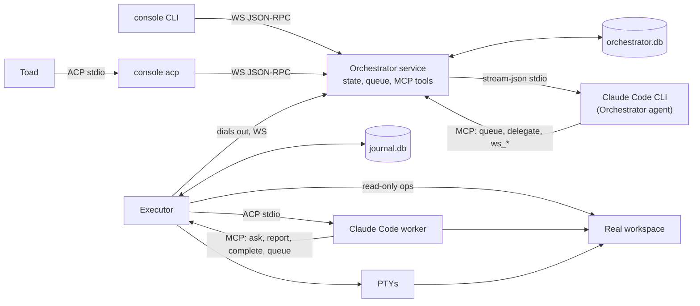

# Implementation plan: v1 local Orchestrator

**Date:** November 22, 2026
**Status:** Proposed. Scope is Phase 1 of [architecture-design.md §16](architecture-design.md), including the shared queue, progressive disclosure, and conversation-first delegation (§3.1–3.4). It is built so Phase 2 (cloud Orchestrator) changes deployment, not contracts.
**Inputs:** [architecture-design.md](architecture-design.md), [industry-research.md](industry-research.md)
**Terminology:** **Orchestrator** = the user's conversational agent and owner of durable state (the design's "coordinator"). **Worker** = a dedicated coding agent (Claude Code) started for a delegated task. **Executor** = the laptop daemon that hosts workers, terminals, and workspace access.

### Decisions made

| Decision | Choice |
|---|---|
| Chat TUI | **Toad**, through our `console acp` bridge. The bridge talks to the Orchestrator service over WebSocket, so the same local TUI works unchanged when the Orchestrator moves to the cloud. Claude Code's own TUI was considered and rejected: it runs its own agent loop, so it can't act as a client of a service-hosted (later cloud-hosted) Orchestrator. |
| Worker agent | **Claude Code**, through its ACP adapter |
| Orchestrator | **A Claude Code agent**, run by the Orchestrator service over ACP, on `claude-opus-5-5` at effort `medium`. It handles conversation inline and delegates only non-trivial work to workers. The policy is tuned over time from recorded decisions. |
| Model access | **Through Claude Code only.** No direct Anthropic API client in v1. |
| Orchestrator isolation *(open)* | Shared Claude Code login, where your skills and plugins load but are inert because no tools are enabled, or a dedicated `CLAUDE_CONFIG_DIR` with a one-time `/login`. See [M0 findings](../spikes/README.md). |
| Worker permissions *(open, needed by M7)* | Workers currently inherit your Claude Code permission mode; an explicit policy is needed before they run unattended |
| Users | **Single user**, with a local token |
| Priority model | Importance × urgency bands (P0 urgent+important, P1 urgent, P2 important, P3 neither) plus sticky manual placement |
| Build order | Conversation-first; see §12 |

## 1. Goal and exit criteria

1. **Conversation first.** "What's the state of the auth module?", "show me what changed in PR 42", and "add a todo to bump tokio" are each answered inline in a few seconds. No task is created; at most a todo is added.
2. **Delegation.** "Fix the flaky auth test in repo-x" makes the Orchestrator say it's handing this off, with a one-line reason, and create a todo, a brief, and a task. A Claude Code worker starts in the real workspace. The conversation keeps going: the next question is answered while the worker runs.
3. **Mediation.** A worker question or permission request shows up in the Orchestrator conversation. My answer goes back to the worker. `/attach` opens the worker's own session in Toad so I can watch or steer it.
4. **Durability.** Close Toad mid-task and reopen it: the same conversation, task, history, diff, and pending decisions are there.
5. **Shared queue.** Todos get proposed kind and priority. My reorders stick. The Orchestrator starts the top ready item it owns. `/why` explains the position of any item.
6. **Progressive disclosure.** Worker progress arrives as L0/L1 digests. `/more` drills down to L2 and then L3 evidence, consistently. `/sync` starts with a headline.
7. **Learning.**
   - Detail preferences adapt per (kind, band) and are announced once, visible in `/prefs`.
   - Every inline-or-delegate decision is recorded with its outcome. `console eval delegation` replays the labeled set against the current policy.
8. **Recovery.** Kill the executor mid-task: the task reconciles and is never silently re-run. Restart the Orchestrator: everything survives.
9. **Terminals.** Open a human terminal in a workspace, detach, and reattach with the screen intact.

**Out of scope for v1:** cloud deployment, Slack, desktop and generated views, voice, org knowledge connectors, cloud workers, parallel workers on the same workspace, and harness/model/placement routing. Seams are reserved for each (§11).

## 2. What we build vs. reuse

| Concern | Choice | Build or reuse |
|---|---|---|
| Worker agent loop | Claude Code via its ACP adapter (any ACP agent can be swapped in through config) | Reuse |
| ACP protocol | `agent-client-protocol` Rust crate | Reuse |
| Orchestrator agent loop | Claude Code CLI in `stream-json` mode (verified in M0). Product tools come from our MCP server, policy from its system prompt, and guardrails from hooks and permission settings. | Reuse |
| Digests and triage | One-shot headless Claude Code calls (`claude -p`, no tools, JSON validated against a schema) | Reuse |
| Worker ↔ Orchestrator tools | MCP server via `rmcp`, attached to worker sessions through ACP `mcpServers` | Reuse SDK; build ~6 tools |
| Chat TUI | Toad via `console acp` | Reuse client; build bridge |
| Fast read-only workspace search | `ignore` + `grep-searcher` crates (ripgrep internals) | Reuse |
| Notifications | `notify-rust` | Reuse |
| Terminals | `portable-pty` + `vt100` | Reuse |
| Runtime, HTTP/WS | `tokio`, `axum`, `tokio-tungstenite` | Reuse |
| Store | SQLite (WAL) via `sqlx` | Reuse |
| Queue ordering | `fractional_index` | Reuse |
| Git | `gix`; `git diff` for patches | Reuse |
| Daemons | `service-manager` (launchd) | Reuse |
| CLI, config, IDs, logs, tests | `clap`, `figment`, `ulid`, `tracing`, `proptest`, `insta`, `assert_cmd` | Reuse |

## 3. Topology



- **Service and agent are separate.** The Rust Orchestrator service owns state, events, the queue, the executor hub, and the MCP tool server. The Orchestrator's reasoning runs in a Claude Code process the service hosts next to itself: on the laptop now, in the same container in cloud mode.
- **One primary conversation.** Toad's default session is the Orchestrator conversation: long-lived and not bound to a workspace.
- **Worker sessions** exist per task. They are attachable (`/attach`) but optional.
- **The Orchestrator never touches the filesystem directly.** Inline lookups go through the executor as read-only, bounded ops, which keeps the Orchestrator cloud-portable.
- **The executor dials the Orchestrator** in local mode too, the same shape as cloud mode.

## 4. Repository layout

```
crates/
  proto/         # IDs, enums, Event, client API + executor link messages
  store/         # sqlx migrations, repositories, event log
  queue/         # todos, ranking, proposals, field ownership (pure)
  disclosure/    # digest levels, delivery policy, preference learning (pure + Summarizer trait)
  cc-host/       # hosts the Orchestrator's Claude Code CLI over stream-json (one prompt in flight)
  acp-host/      # ACP client that hosts Claude Code workers via the ACP adapter
  agent/         # Orchestrator agent: CLAUDE.md, settings, hooks, MCP tool server, turn records, briefs
  orchestrator/  # server, task engine, dispatcher, scheduler, executor hub, decision broker
  executor/      # link, journal, workspace registry, read-only ops, ACP worker host, MCP server, PTYs
  acp-bridge/    # `console acp`
  client/        # Rust client for the Orchestrator API
  console/       # binary
evals/delegation/  # labeled turns (JSONL) + runner
tests/e2e/
```

## 5. The Orchestrator agent

### 5.1 Hosting and turn loop

The Orchestrator service runs one long-lived **Claude Code process** as the Orchestrator's brain. It drives the Claude Code CLI in `stream-json` mode (`cc-host`) with `--tools ""`, `--strict-mcp-config`, `--setting-sources ""`, `--settings` (permissions and hooks), `--system-prompt`, `--model`, and `--effort`, all verified in M0 ([findings](../spikes/README.md)). Claude Code supplies the agent loop, streaming, context compaction, prompt caching, and session resume. We supply:

- **A dedicated home and config directory** (`~/.console/orchestrator/agent/`), so it never picks up a project's `CLAUDE.md` or your personal Claude Code settings. Its `CLAUDE.md` holds the Orchestrator role, the delegation policy, and the promoted delegation examples (§5.5).
- **Settings:** model `claude-opus-5-5`, effort `medium`, the permission rules and hooks in §5.3, and our MCP server as the only tool source.
- **Product tools** from the service's MCP server (`rmcp`), which the agent sees as `mcp__console__*` tools.

Each user message is a **turn**, not a task:

1. The service persists the message (outbox event) and writes it to Claude Code as a stream-json user message. **Only one prompt is in flight at a time:** the next one is sent after the `result` message, because M0 showed that queued messages merge into a single turn.
2. A `UserPromptSubmit` hook injects per-turn state as additional context: queue top N, active tasks, waiting-on-you items, digests delivered since the last turn, and the time.
3. Stream-json events (text, tool use, tool results, usage) are translated to client events, streamed, and persisted.
4. When the turn ends, the service writes a **turn record** (§5.5) from the ACP updates and the hook log.

**Durability:** our event log and turn records are authoritative; Claude Code's own session files are adapter data. After a restart, the service relaunches with `--resume <session_id>` (verified in M0). If that fails, it starts a fresh session seeded with a summary built from our records.

### 5.2 Tools

Claude Code's built-in tools that touch the local machine (`Read`, `Write`, `Edit`, `Glob`, `Grep`, `Bash`, `NotebookEdit`) are disabled, and so is its subagent tool. The Orchestrator reaches workspaces only through executor-backed MCP tools, so local and cloud modes behave the same.

| Group | Tools | Constraints |
|---|---|---|
| Workspace (inline, via executor) | `ws_list`, `ws_read_file`, `ws_search`, `git_status`, `git_log`, `git_diff`, `git_show`, `run_readonly` | **Read-only by construction.** `run_readonly` runs only commands on a configurable allowlist (for example `gh pr view`, `gh pr diff`, `cargo metadata`), with a timeout and an output cap. |
| Queue | `queue_list`, `todo_add`, `todo_update`, `todo_move`, `todo_drop`, `proposal_resolve` | User-set fields go through the proposal rules (§7.2) |
| Work | `delegate_task`, `task_status`, `task_message` (steer), `task_cancel`, `decision_answer`, `digest_expand` | `delegate_task` is the only way work gets a worker |
| Memory | `prefs_get`, `prefs_set` | Explicit preference statements are pinned |

### 5.3 Delegation policy

**Soft policy (system prompt plus examples):**
- **Inline:** questions, explanations, planning, short read-only lookups, queue and status operations, and drafting text that doesn't touch a workspace.
- **Delegate:** any workspace change; anything likely to take more than a minute or two or many steps; builds and test runs; multi-step investigations; non-trivial PR reviews; anything the user would naturally hand off.
- **When unsure,** pick one and say which in a single line ("Handing this to a worker: it touches several files"). Ask only when the target workspace or the goal is unclear.

**Hard guardrails, enforced outside the model:**
1. **Read-only inline work.** Claude Code's permission settings deny its file-writing, shell, and subagent tools, and our workspace tools are read-only by construction. A mutating request can only be met by delegating.
2. **Inline budget per turn:** at most 10 tool calls and 90 s wall time (configurable).
   - A `PreToolUse` hook (`console hook pre-tool`) asks the service for the turn's tool-call count.
   - Near the limit, the hook lets the call through with a note to finish or delegate.
   - At the limit, it denies every tool except `delegate_task`, with a reason telling the agent to delegate.
   - Escalating passes the turn's findings into the brief.
3. Delegation never blocks the conversation. The turn ends with the handoff message.
4. **Concurrency:** at most 1 active worker per workspace and 2 in total, enforced by the service when `delegate_task` runs. Extra work is queued as `ready` todos, and the Orchestrator says so.

**User overrides:** `/delegate` forces a handoff of the last request. `/inline` (or "just answer here") forces inline, within the guardrails. Both are recorded.

### 5.4 Briefs and mediation

`delegate_task` takes a structured **brief**: title, goal, relevant context from the conversation (including findings from inline lookups), constraints, acceptance criteria, suggested checks, workspace, `todo_id` (existing or new), and `foreground` (whether to suggest attaching). The brief is stored as an artifact and rendered as the worker's first prompt.

Workers get an MCP server (hosted by the executor, proxied to the Orchestrator) with these tools:

| Tool | Purpose |
|---|---|
| `ask_orchestrator(question)` | The task is blocked with reason `AwaitingInput`. The question appears in the conversation, and the user's answer returns as the worker's next prompt. |
| `report_progress(note)` | Feeds digests |
| `complete(summary, evidence)` | Declares the task done. A turn that ends without `complete` is treated as needing input, and the Orchestrator classifies it. |
| `propose_followup(todo)`, `mark_blocked(reason)` | Queue updates; follow-ups land in `inbox` as proposals |

ACP permission requests from workers become decisions, surfaced in the conversation the same way.

### 5.5 Turn records and tuning the policy

Every turn stores:
- the decision (`inline`, `delegate`, or `ask`) and the model's stated reason;
- the inline tool count and wall time, and whether the budget was hit or the turn escalated;
- for delegated work, the task's eventual duration, tool calls, files changed, and outcome;
- any user override.

**Derived labels:**

| Label | Evidence |
|---|---|
| `should_have_delegated` | Budget hit, mid-turn escalation, or `/delegate` |
| `should_have_inlined` | Task finished in under 60 s with no file changes, or `/inline` / "you could have just answered" |

**Tuning loop (manual in v1, which is the "fine-tune over time" part):**
- `console delegation review` lists labeled turns.
- Promote good cases into `evals/delegation/examples.toml`. They are rendered into the Orchestrator's `CLAUDE.md`.
- `console eval delegation` replays each labeled turn's message and state in a throwaway Orchestrator session with the current `CLAUDE.md` and stubbed tools. It records whether the turn delegated and reports the confusion matrix. Run it before shipping any policy change.
- Hard guardrails never change through tuning.

## 6. Core contracts

### 6.1 Identifiers

ULID newtypes: `SessionId`, `TurnId`, `TodoId`, `TaskId`, `AttemptId`, `CommandId`, `ExecutorId`, `WorkspaceId`, `ArtifactId`, `DecisionId`, `DigestId`, `ProposalId`, `TerminalId`, plus `EventSeq` and `AuthorityEpoch`.

### 6.2 Store

| Table | Key columns |
|---|---|
| `sessions` | id, kind (`orchestrator` or `worker`), task_id?, harness_session_ref, title |
| `turns` | id, session_id, user_message, transcript json (ACP updates, for replay and evals), decision, reason, tool_calls, wall_ms, budget_hit, escalated, override, label |
| `todos`, `todo_deps`, `proposals` | As in §7 |
| `tasks` | id, todo_id, origin_turn_id, brief_artifact_id, worker_session_id, state, blocked_reason (`AwaitingInput`, `AwaitingDecision`, `WaitingExecutor`), idempotency_key |
| `attempts`, `commands`, `decisions`, `artifacts`, `terminals`, `executors`, `workspaces` | As in the design |
| `digests`, `deliveries`, `disclosure_signals`, `disclosure_prefs` | As in §8 |
| `events` | seq, session_id?, task_id?, todo_id?, kind, payload, ts |

The outbox rule applies everywhere. Worker output chunks are coalesced before they are persisted.

### 6.3 Task state machine

Unchanged from design §8.3, plus the blocked reasons above. Tasks are created **only** by `delegate_task` (or by `todo.start` on a todo that already has a brief).

### 6.4 Client API (JSON-RPC over WebSocket)

| Method | Behavior |
|---|---|
| `session.attach` / `events.subscribe` | Snapshot plus cursor replay, for the Orchestrator conversation or a worker session |
| `turn.submit {text, idempotency_key}` | Starts an Orchestrator turn and streams it. **Does not create a task.** |
| `turn.override {turn_id, inline or delegate}` | Records the override and re-runs if needed |
| `worker.prompt {task_id, text}` | Sends a direct message when attached to a worker session |
| `queue.*`, `todo.*`, `proposal.*`, `sync.digest`, `digest.expand`/`collapse`, `prefs.*` | As in the earlier draft |
| `task.*`, `decision.respond`, `terminal.*`, `artifact.get` | As before |

### 6.5 Executor link

Unchanged: dial-out, Hello/Welcome with epoch, Dispatch/Accepted/Duplicate, Progress/Result, Reconcile, journal, and terminal frames. New:
- `ReadOp {op, args, deadline}` for inline workspace tools. Read ops are not journaled; they are idempotent and bounded.
- `McpCall` to proxy worker tool calls.

## 7. Shared priority queue

1. **Band** from importance × urgency (both scored 1–4; "high" means 3 or more, and a due date within 48 h makes urgency high):

   | Band | Importance | Urgency | Examples | Default handling |
   |---|---|---|---|---|
   | **P0** | High | High | Prod or main broken, a teammate blocked on you, due today | Top of the queue; updates always pushed |
   | **P1** | Low | High | Quick review request, someone waiting on an answer, a small deadline-bound bump | Cleared quickly, ahead of planned work; good candidates for the Orchestrator to handle on its own |
   | **P2** | High | Low | Planned feature, meaningful refactor, design work | The main body of work, in rank order |
   | **P3** | Low | Low | Chores, cleanup, nice-to-haves | Batched; L0 updates by default |

   Urgent items rank above important-but-not-urgent ones, so time-sensitive requests clear first (confirmed November 22, 2026).
2. **Score within the band** from urgency, importance, items unblocked, age, and a blocked penalty.
3. **Manual placement** with fractional `manual_rank`, which sticks.
4. A **`why`** string for every item. `waiting_on_user` items are always listed first.

**Field ownership:** user-set fields change only through proposals with a rationale, which expire if ignored. Optimistic concurrency uses `expected_version`.

**Triage:** new todos get proposed kind, importance, urgency, and workspace from a headless Claude Code call at effort `low`, validated against a schema. Corrections are recorded as triage examples.

**Scheduler:** starts `ready` todos owned by the Orchestrator that have a brief, in rank order, within the concurrency limits. No preemption; a new P0 goes next, with an L0 note.

## 8. Progressive disclosure and learning

| Level | When generated | Source |
|---|---|---|
| L0 + L1 | Eagerly, at milestones: task terminal, `ask_orchestrator`, decision needed, blocked or unblocked, `complete`, and every ~10 min on long tasks | One headless Claude Code call (`claude -p`, no tools, effort `low`) over the event range; output validated against `{headline, needs_you, bullets, risks}` |
| L2 | Lazily, on expand | L1 plus the same events plus artifact summaries; cached |
| L3 | On expand | Links to raw events, patch, and logs (no LLM) |

- **Grounding:** each digest stores its event range, and deeper levels receive the shallower ones as input.
- **Fallback:** if generation fails, a deterministic template digest is delivered instead.
- **Delivery:** digests are delivered into the Orchestrator conversation at the level preferred for that bucket.
  - **Bucket resolution:** `(kind, band) → (kind, *) → (*, band) → (*, *)`.
  - **Push modes:** `now` (message plus desktop notification), `batch` (held for the next `/sync`), or `on_done`.
  - **Overrides:** anything that needs you, and anything P0, is always pushed now at L1 or deeper.

**How learning works:**
- **Signals:** expanded, collapsed, ignored, a follow-up the next level would have answered, and explicit statements.
- **Update rule:** move one level when 3 of the last 5 signals agree.
- **Explicit statements:** pinned, and never changed silently.
- **Announcements:** every change is announced once, with its evidence, and visible in `/prefs`.

When the user asks about a running task, the Orchestrator answers inline from digests and `task_status`, starting at the preferred level.

## 9. Clients

### `console acp` (Toad)

- `console acp` is the **Orchestrator conversation**.
  - Streamed text becomes `agent_message_chunk`.
  - Inline tool calls appear as collapsed `tool_call` updates.
  - Delegation appears as a tool call titled "Delegated → T-123: Fix flaky auth test (repo-x)".
  - The queue's top N is mirrored as ACP plan entries.
  - Digests pushed with mode `now` arrive as messages, or as notifications if Toad doesn't render out-of-turn updates (checked in M0).
- `console acp --task <id>` is a **worker session**. It replays the worker's stream and passes prompts to the worker via `worker.prompt`.
- **Slash commands:** `/queue`, `/next`, `/sync`, `/more [n]`, `/less`, `/why`, `/add`, `/prefs`, `/proposals`, `/tasks`, `/attach <task>` (prints or launches the worker-session command; the M0 prototype checks whether Toad can open a second session directly), `/delegate`, `/inline`, `/decisions`, `/diff`, and `/term`.

### `console` CLI

`up`/`down`/`status`, `workspace`, `queue`, `todo`, `sync`, `prefs`, `tasks`, `inspect` (including LLM spend and the delegation decision for a turn), `logs`, `term`, `decide`, `delegation review`, and `eval delegation`.

## 10. Model usage summary

All model calls go through Claude Code. v1 has no direct Anthropic API client, and it uses whatever credentials Claude Code is logged in with.

| Job | How | Model / effort |
|---|---|---|
| Orchestrator conversation | Long-lived Claude Code CLI session over stream-json | `claude-opus-5-5` / `medium` |
| Workers | One Claude Code session per task over ACP, on the executor | Claude Code's configured default |
| Digests L0/L1, triage | Headless one-shot `claude -p`, no tools, JSON validated against a schema | `claude-opus-5-5` / `low` |
| Digest L2 | Same, on expand | `claude-opus-5-5` / `medium` |
| Delegation eval | Throwaway Orchestrator sessions with stubbed tools | Same as the conversation |

Usage is logged per turn, digest, and task from what Claude Code reports, with a daily budget in config. Digests and triage sit behind a `Summarizer` trait, so a direct API path can be added later if Claude Code's per-call overhead proves too slow or costly for high-volume digests.

## 11. Seams for later phases

| Later need | Seam |
|---|---|
| Cloud Orchestrator | The agent uses only executor-mediated workspace access; dial-out executors; epoch fencing; portable SQL |
| Slack, desktop, voice | Each is another client of the conversation and its digests. Voice maps naturally to conversation-first turns plus delegated tasks. |
| Routing | `delegate_task` is the single choke point where the choice of harness, model, and placement goes later |
| Cloud workers | Briefs are portable; workers are another executor type |
| Memory | `disclosure_prefs` and delegation examples follow the design's memory rules |
| Generated views | Digests, briefs, and patches are versioned artifacts |

## 12. Milestones (conversation-first order)

| # | Milestone | Done when |
|---|---|---|
| **M0** | Prototypes (spikes) | ✅ **Done on November 22, 2026.** Toad, the Claude Code worker via ACP, PTY reattach, and Claude Code as the Orchestrator were all verified. See [spikes/README.md](../spikes/README.md) for findings and resulting plan changes. |
| **M1** | Skeleton | Crates, wire snapshots, config, tracing, CI |
| **M2** | Orchestrator core | Store, event log and replay, task state machine (property tests), client API |
| **M3** | Executor + link | Pairing, epoch, journal, workspaces, `ReadOp`s (read-only, bounded, allowlisted), `Exec`, Reconcile, kill/restart test |
| **M4** | Queue | Ranking, placement, `why`, proposals, field ownership (property tests), scheduler |
| **M5** | **Orchestrator agent** | `acp-host` + `agent` crates: a hosted Claude Code session, the MCP tool server (inline, queue, work, and memory tools), permission settings and hooks for guardrails and budget escalation, `delegate_task` with briefs (fake worker), turn records, and restart/resume. Acceptance: exit criterion 1, and criterion 2 with a fake worker. |
| **M6** | Toad bridge | Orchestrator conversation plus worker sessions, slash commands, notifications. From here on, you can use it daily. |
| **M7** | Workers | Claude Code via ACP in the executor, brief as the first prompt, MCP tools (ask, report, complete, follow-ups), mediation, steering, permission→decision, patch artifacts. Acceptance: exit criteria 2–4. |
| **M8** | Digests + delivery | L0–L3 with grounding and template fallback, push/batch/on_done, `/sync`, an eval of about 20 recorded tasks (no contradictions, `needs_you` never dropped). Acceptance: exit criterion 6. |
| **M9** | Learning | Disclosure signals and the update rule, pins, announcements, `/prefs`. Delegation labels, `delegation review`, `eval delegation`, the example store. Acceptance: exit criterion 7. |
| **M10** | Terminals | PTY manager, snapshots, `console term`. Acceptance: exit criterion 9. |
| **M11** | Daemons + hardening | launchd, restart recovery, `OutcomeUnknown` flow, `inspect`, e2e failure suite, scripted demo. Acceptance: exit criteria 5 and 8 end to end. |

Rough size for one engineer:

| M0 | M1 | M2 | M3 | M4 | M5 | M6 | M7 | M8 | M9 | M10 | M11 |
|---|---|---|---|---|---|---|---|---|---|---|---|
| 3 | 1–2 | 4–5 | 4–5 | 3–4 | 4–6 | 3–4 | 4–6 | 4–5 | 4–5 | 2–3 | 3–5 |

All figures are working days, about **9–10 weeks** in total. M4 can run in parallel with M3.

## 13. Risks

| Risk | Mitigation |
|---|---|
| Delegation threshold feels wrong (too eager or too chatty) | Hard guardrails bound the worst cases; overrides are one command; turn records, labels, and the eval give a tuning loop from day one |
| Inline lookups creep into doing real work | Read-only tools, allowlist, per-turn budget with forced escalation |
| Long-lived conversation context grows | Claude Code's auto-compaction, per-turn state injected by hook rather than accumulated, digests instead of raw worker output in the main conversation |
| Claude Code's built-in prompt adds overhead to every one-shot digest call | Tools disabled for those calls; overhead measured in M0; the `Summarizer` trait allows a direct API path |
| Hook, settings, or ACP-adapter behavior changes between Claude Code releases | Pin Claude Code and adapter versions; e2e tests assert the guardrails (a mutating tool is denied; the budget forces delegation) |
| The Orchestrator's Claude Code inherits your personal settings, memory, or MCP servers | Its own config directory and explicit settings; isolation verified in M0 |
| Toad UX limits (concatenated messages, two-step slash commands, multi-session) | M0 confirmed out-of-turn rendering, plan panel, and replay on `session/new`; the bridge adds message separators; `/attach` opens a separate Toad instance |
| Workers end turns ambiguously (M0: a worker backgrounded a command and ended its turn early) | Explicit `complete` and `ask_orchestrator` tools stated in every brief; a turn that ends without `complete` means needs-input |
| Worker processes outlive the worker (M0: an orphaned background command finished after the adapter exited) | The executor runs each worker in its own process group or session and kills the group when a task ends or is cancelled |
| ACP or adapter churn | Versions recorded in M0 (adapter 0.109.1, `agent-client-protocol` 5.5.1, Claude Code 2.1.330); pinned installs, no npx at runtime; isolated modules |
| Digest drift, learning oscillation, LLM cost | Grounding and evals; one-step moves with pins; effort `low`, lazy L2, caching, budget |
